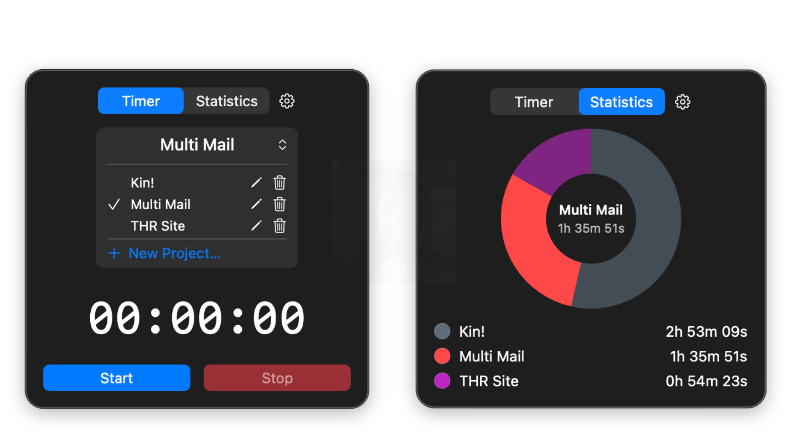
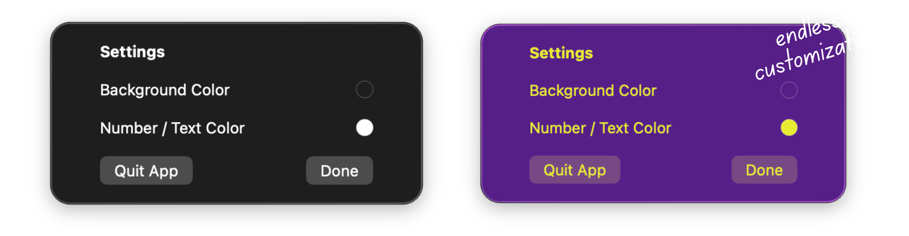

#<p align="center">
  
</p>

<h1 align="center">Clocked</h1>

<br>

A tiny macOS menu bar app that tracks how much time you spend on different projects. 

No accounts. No streaks. No notifications. No "productivity tips." Just pick a project, hit start, and it counts.

## Preview




## Download

Grab the latest [Clocked.dmg](https://github.com/izzyflestado/Clocked/releases/download/V1.0.0/Clocked.dmg) from the [Releases page](https://github.com/izzyflestado/Clocked/releases).

## What it does

- Lives in your menu bar. Click it, get a popover.
- **Timer tab** — pick/create/rename/delete projects, big readout, Start/Pause/Stop.
- **Stats tab** — pie chart + list of totals per project, each with its own customizeable color.
- Menu bar icon shows the live time while a timer's running. Logo shows when it's paused or stopped.
- Settings:
  - Customize background and text color.
  - Quit app.

## Stack

SwiftUI, SwiftData, Swift Charts.

## Running it

```bash
swift build
swift run
```

Requires macOS 14+.
