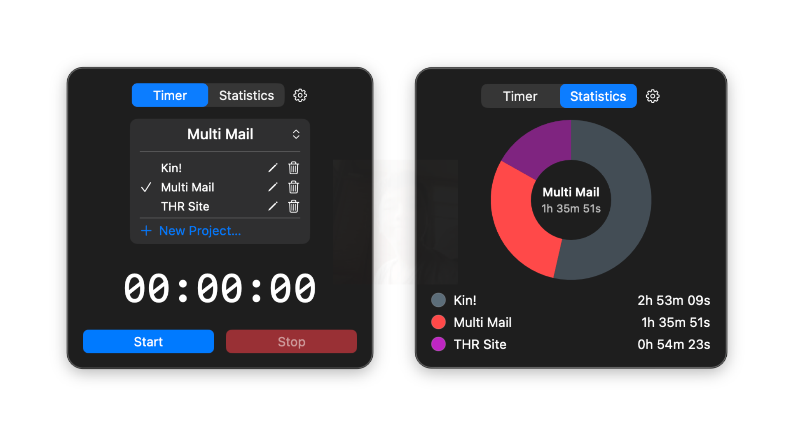
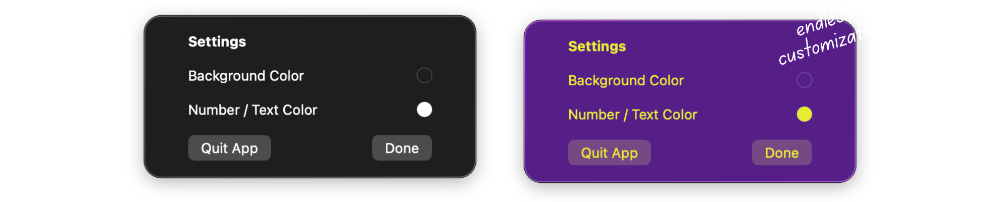

# Clocked - Project Time Tracker

A tiny macOS menu bar app that tracks how much time you spend on different projects. 

No accounts. No streaks. No notifications. No "productivity tips." Just pick a project, hit start, and it counts.

## Preview




## What it does

- Lives in your menu bar. Click it, get a popover.
- **Timer tab** — pick/create/rename/delete projects, big readout, Start/Pause/Stop.
- **Stats tab** — pie chart + list of totals per project, each with its own customizeable color.
- Menu bar icon shows the live time while a timer's running. Nothing shows when it's paused or stopped.
- Two colors you can customize: background and text. Quit app. That's the entire settings screen.

## Stack

SwiftUI, SwiftData, Swift Charts.

## Running it

```bash
swift build
swift run
```

Requires macOS 14+.
